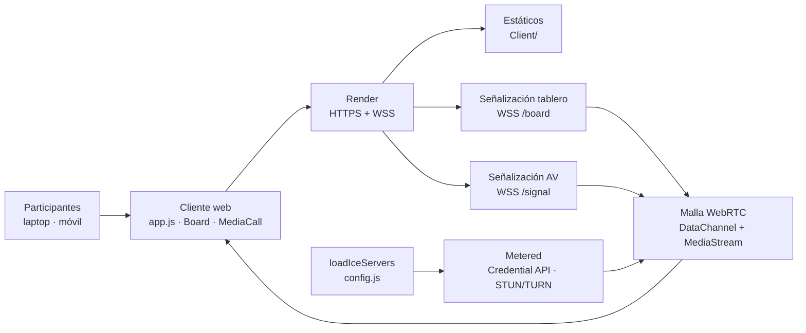

# Especificación para generar el PDF del proyecto Pizarra

> **BLOQUE DE INSTRUCCIONES PARA LA IA QUE GENERARÁ EL PDF — NO INCLUIR EN EL DOCUMENTO FINAL**

## Objetivo del PDF

Generar un PDF en **español** titulado **«Pizarra colaborativa: arquitectura, código y comunicaciones WebRTC»**, destinado a una persona técnica que quiere entender el proyecto `BoardProject` desde cero. Debe explicar:

1. Qué hace el proyecto y qué problema resuelve.
2. La arquitectura general (componentes, capas y flujos).
3. El código relevante, archivo por archivo, con fragmentos comentados.
4. Los conceptos básicos de red implicados: WebSocket, WebRTC, SDP, ICE, STUN, TURN, NAT, DataChannel y autoplay.
5. La decisión concreta de usar STUN/TURN gratuito de Metered y por qué Render no hace de TURN.
6. Cómo se despliega, se prueba y se verifica.

## Requisitos de maquetación

- Tamaño A4, márgenes de 20 mm, tipografía serif para el cuerpo (11 pt) y monospace para código (9 pt).
- Portada con título, subtítulo «Documentación técnica del repositorio BoardProject», fecha de generación y versión del documento.
- Índice automático al inicio.
- Encabezado con el título corto y pie de página con número de página.
- Un salto de página antes de cada sección numerada principal.
- Los fragmentos de código en cajas con fondo gris claro, sin resaltado de sintaxis agresivo, y con una leyenda encima indicando `archivo:rango`.
- Las tablas con cabecera oscura y filas alternas.
- Diagrama: usar la imagen `archify-out/pizarra-arquitectura.visual-check.2048x1320.light.png` si se puede incrustar; si no, reproducir el diagrama en texto usando el bloque Mermaid del apéndice A. **No inventar componentes nuevos.**
- Extensión orientativa: 25–35 páginas. No repetir el mismo contenido en varias secciones.
- **Seguridad:** en todos los fragmentos de código donde aparezcan credenciales, sustituirlas por marcadores `<METERED_API_KEY>`, `<TURN_USERNAME>` y `<TURN_CREDENTIAL>`. Nunca imprimir los valores reales. Indicar que están en `Client/js/config.js` y que son de ámbito *credential*, no el *secret* de la cuenta.
- No afirmar cosas que no estén en este documento. Si falta información, decir «no especificado en el repositorio».

---

# INICIO DEL CONTENIDO DEL PDF

# Pizarra colaborativa: arquitectura, código y comunicaciones WebRTC

## 1. Resumen ejecutivo

`BoardProject` es una pizarra colaborativa en tiempo real que se abre en el navegador. Varias personas conectadas desde distintos equipos pueden dibujar al mismo tiempo, ver el cursor de los demás y activar una videollamada entre pares sin que el vídeo pase por el servidor.

El sistema tiene tres piezas bien separadas:

- **Cliente web** (`Client/`): interfaces, canvas, lógica de dibujo, videollamada y configuración de red.
- **Servidor** (`Server/`): sirve los archivos estáticos, gestiona la sala del tablero, reenvía la señalización WebRTC y mantiene el transporte alternativo.
- **Infraestructura externa**: Render hospeda el servidor y Metered proporciona STUN/TURN gratuito para que la conexión funcione incluso cuando el enlace directo entre dispositivos no es posible.

La idea central es que el servidor **no reenvía los trazos ni el vídeo** en el modo principal: solo presenta a los participantes y transporta los mensajes de señalización. Una vez que los navegadores se conocen, intercambian datos por WebRTC (DataChannel para la pizarra y MediaStream para cámara y micrófono). Si WebRTC no puede establecerse, existe un camino de respaldo por WebSocket.

| Necesidad | Tecnología | Papel |
|---|---|---|
| Cargar la aplicación | HTTPS desde Render | Archivos estáticos de `Client/` |
| Entrar a la sala | WebSocket `/board` o DataChannel | Estado, trazos, presencia, cursores |
| Anunciar cámaras | WebSocket `/signal` | Ofertas/respuestas SDP y candidatos ICE |
| Enviar vídeo y audio | WebRTC entre pares | MediaStream directo o vía TURN |
| Descubrir la IP pública | STUN (Google + Metered) | Candidatos `srflx` |
| Saltar NAT restrictivo | TURN de Metered | Candidatos `relay` |

## 2. Qué hace el proyecto

### 2.1 Funcionalidades de la pizarra

- Herramientas: pincel, borrador, cubeta, línea, rectángulo y círculo.
- Paleta de colores, tamaños de pincel y borrador, recientes, tema claro/oscuro.
- Lienzo con dos capas: una capa base con el contenido consolidado y una capa overlay con la vista previa y los cursores remotos.
- Presencia: lista de participantes, cantidad de usuarios, nombre y color.
- Cursores remotos con nombre.
- Sincronización de trazos en tiempo real y estado inicial mediante `snapshot` al conectarse.
- Deshacer/rehacer local, cola offline de mensajes mientras se reconecta, latencia medida con `ping`/`pong`.
- Persistencia desactivada: la pizarra se reinicia cuando se desconecta el último cliente.

### 2.2 Funcionalidades de la videollamada

- Se activa manualmente con el botón «Cámara»; nunca se une automáticamente.
- Sala propia derivada de la sala del tablero: `<sala>-av` (por defecto `pizarra-av`), para no mezclar señalización de vídeo con el DataChannel del tablero.
- Cada participante publica su cámara y micrófono como `Sender` y recibe a los demás como `Receiver`.
- Panel flotante con rejilla de fichas, vídeo local, indicador de habla, controles de micro, cámara, dispositivos y colgar.
- El micrófono se puede silenciar desde el botón correspondiente; el estado se difunde a los demás participantes.
- Si el navegador bloquea el autoplay con audio (caso típico en Android Chrome/Opera), el vídeo se reproduce silenciado y aparece un botón de altavoz en cada ficha para activar el sonido manualmente.
- Si no hay cámara, la llamada continúa solo con audio.

### 2.3 Límites y restricciones

- `getUserMedia` exige un contexto seguro: HTTPS o `http://localhost`. En una IP local por HTTP, el navegador bloquea la cámara; por eso Render termina TLS.
- El servidor cabecera `Permissions-Policy: camera=(self), microphone=(self)`.
- `access.mode: open` permite cualquier origen en la red; `allowlist` restringe por IP (aunque DHCP puede cambiarla).
- Límites configurados: 5000 trazos, 10000 puntos por trazo, 2000000 puntos totales y 500 mensajes por segundo.

## 3. Arquitectura general

### 3.1 Vista de componentes



El diagrama editable y validado está en `archify-out/pizarra-arquitectura.html`, con capturas y receipt en la misma carpeta.

### 3.2 Capas

| Capa | Archivos | Responsabilidad |
|---|---|---|
| Interfaz | `Client/index.html`, `Client/style.css`, `Client/styles/*.css` | Controles, panel de llamada, temas, iconos SVG |
| Estado y canvas | `Client/js/state.js`, `Board.js`, `dom.js`, `utils.js` | Estado global, dos capas de canvas, selectores, utilidades |
| Comunicación cliente | `Client/js/Communication.js`, `P2PCommunication.js` | Intenta DataChannel; cae a WebSocket a los 8 s |
| Videollamada | `Client/js/MediaCall.js`, `vendor/p2p.esm.js` | Captura de medios, señalización AV, fichas y audio |
| Configuración | `Client/js/config.js` | URL del servidor, credenciales ICE, paleta, constantes |
| Servidor HTTP | `Server/src/static.js`, `index.js` | Archivos estáticos y rutas de upgrade |
| Servidor de sala | `Server/src/communication.js` | Validación y difusión de trazos, presencia y snapshot |
| Señalización | `Server/src/signaling.js`, `peer-server.js` | Broker `sender`/`receiver` y Sender P2P del servidor |
| Adaptador P2P | `Server/src/peer-socket.js` | DataChannel con interfaz de socket para `Communication` |
| Configuración servidor | `Server/src/config.js`, `Server/config.yaml` | Defaults, validación, TLS, access, límites, ICE |

### 3.3 Dos canales, dos propósitos

Es importante no confundirlos:

- **`/board`** transporta la lógica de la pizarra. Si el DataChannel P2P funciona, esos mensajes viajan dentro del canal `board`; si no, viajan por WebSocket.
- **`/signal`** transporta únicamente la señalización de la librería `p2p` (`subscribe`, `unsubscribe`, `publish` sobre namespaces `sender`/`receiver`). Es el equivalente a una «agenda» para que los pares se encuentren.

El vídeo y el audio **nunca** pasan por ninguno de los dos canales: viajan por pistas WebRTC separadas.

## 4. Estructura del repositorio

```text
BoardProject/
├── Client/
│   ├── index.html                  # Marcado y sprite de iconos
│   ├── style.css                   # Punto de entrada de estilos
│   ├── styles/
│   │   ├── base.css
│   │   └── components.css
│   ├── app.js                      # Orquestador de la aplicación
│   └── js/
│       ├── Board.js                # Dos capas de canvas
│       ├── Communication.js        # P2P con fallback WebSocket
│       ├── P2PCommunication.js     # Driver de señalización + Receiver
│       ├── MediaCall.js            # Videollamada y panel flotante
│       ├── config.js               # Configuración y carga de ICE
│       ├── dom.js                  # Referencias al DOM
│       ├── state.js                # Estado global
│       ├── utils.js                # Utilidades
│       └── vendor/p2p.esm.js       # Librería P2P empaquetada (no editar)
├── Server/
│   ├── config.yaml                 # Configuración desplegada
│   ├── package.json                # pnpm, Node >= 20, dependencias
│   ├── src/
│   │   ├── index.js                # Arranque y routing de upgrades
│   │   ├── config.js               # Lectura y validación de YAML
│   │   ├── communication.js        # Sala del tablero
│   │   ├── signaling.js            # Broker de señalización
│   │   ├── static.js               # Servidor de archivos
│   │   ├── peer-server.js          # Sender P2P del servidor
│   │   └── peer-socket.js          # Adaptador DataChannel -> socket
│   └── test/                       # 18 pruebas con node:test
├── Documentacion/
│   ├── Explicacion_Simple.txt
│   ├── Explicacion_Tecnica.txt
│   ├── Videollamada.txt
│   └── Guia_PDF_Proyecto.md        # Este documento
├── archify-out/                    # Diagrama generado y evidencias
└── render.yaml                     # Definición del servicio en Render
```

## 5. Configuración del cliente

### 5.1 Descubrimiento automático del servidor

`Client/js/config.js` calcula `SERVER_URL` sin intervención del usuario:

```js
// Client/js/config.js
const configuredServer = params.get("server")?.trim();
const pageHost = window.location.hostname;
const pagePort = window.location.port;
const pageProtocol = window.location.protocol;
const localHosts = new Set(["", "localhost", "127.0.0.1", "::1", "[::1]"]);
const isLocalPage = localHosts.has(pageHost.toLowerCase());

const wsProtocol = pageProtocol === "https:" ? "wss:" : "ws:";

const autoHost = (() => {
  if (!isHttpPage) return "";
  if (pagePort === "3005" || pagePort === "") return window.location.host;
  if (!isLocalPage) return `${pageHost}:3005`;
  return "";
})();

export const SERVER_URL = configuredServer || (host ? `${wsProtocol}//${host}` : "");
```

Reglas resultantes:

- Si la página la sirve el propio servidor (puerto 3005, o Render en 443), se usa el mismo host.
- Si la página se sirve desde otro puerto de la misma máquina, se apunta al 3005.
- Se puede forzar con `?server=ws://IP_DEL_SERVIDOR:3005`.
- No se inventa una IP fija: `SERVER_HOST` queda vacío para que la detección automática funcione en cualquier red.

### 5.2 Carga de credenciales ICE

La configuración de TURN tiene dos niveles:

1. `TURN_SERVERS`: copia estática de respaldo con cuatro entradas (puertos 80 y 443, UDP, TCP y TURNS).
2. `loadIceServers()`: petición a la Credential API de Metered al arrancar; si la respuesta es válida se usa, y si falla se cae al respaldo.

```js
// Client/js/config.js
const METERED_TURN_URL = "https://pizarra.metered.live/api/v1/turn/credentials";
const METERED_TURN_API_KEY = "<METERED_API_KEY>";

const BASE_ICE_SERVERS = [{ urls: "stun:stun.l.google.com:19302" }];

export const loadIceServers = async () => {
  try {
    const response = await fetch(METERED_TURN_URL + "?apiKey=" + encodeURIComponent(METERED_TURN_API_KEY));
    if (!response.ok) throw new Error("HTTP " + response.status);
    const servers = await response.json();
    if (!Array.isArray(servers) || !servers.some((server) => String(server?.urls || "").startsWith("turn"))) {
      throw new Error("Respuesta TURN inválida");
    }
    return withUrlTurn([...BASE_ICE_SERVERS, ...servers]);
  } catch (error) {
    console.warn("[ICE] No se pudieron renovar las credenciales TURN; se usa la configuración estática.", error);
    return ICE_SERVERS;
  }
}
```

Además, `readTurnParam()` permite inyectar un TURN distinto con `?turn=url|usuario|clave` o con un array JSON, útil para pruebas con otro proveedor.

### 5.3 Arranque asíncrono

`Client/app.js` espera a que las credenciales estén listas antes de crear los objetos de comunicación:

```js
// Client/app.js
const init = async () => {
  if (state.initialized) return;
  state.initialized = true;

  const iceServers = await loadIceServers();
  communication = new Communication({ iceServers });
  // ...
};

mediaCall = new MediaCall({
  serverUrl: () => normalizeServerUrl(SERVER_URL),
  room: callRoom(),
  iceServers,
  onNotice: (type, message) => showToast(type, message),
  onChange: updateCallButton,
  announce: (message) => { els.srLive.textContent = message; },
});
```

El mismo array `iceServers` se usa para el tablero y para la videollamada. `communication` se declara como `null` y se crea dentro de `init()` para no construir un `WebSocket` con una configuración incompleta.

## 6. Código del cliente

### 6.1 `app.js`: el orquestador

Es el archivo más grande. No dibuja directamente: coordina herramientas, eventos, socket, reconexión y UI.

Responsabilidades principales:

- Registrar gestores de puntero, teclado, rueda y controles.
- Convertir eventos del puntero en puntos normalizados y enviarlos en lotes (`stroke-points`).
- Mantener `state.strokes` y `state.users` sincronizados con los mensajes del servidor.
- Enviar `hello`, `cursor`, `ping` y los mensajes de trazo.
- Aplicar `snapshot`, `presence`, `stroke*`, `clear`, `cursor`, `pong` y `error` cuando llegan.
- Programar redibujados con `requestAnimationFrame` para no bloquear el hilo principal.
- Crear `MediaCall` y enrutar los avisos a notificaciones y a la región `aria-live`.

### 6.2 `Board.js`: dos capas de canvas

```js
// Client/js/Board.js
export class Board {
  #base;
  #overlay;

  constructor({ base, overlay }) {
    this.#base = base;
    this.#overlay = overlay;
  }

  resize(width, height, dpr) {
    if (this.#base.width !== width || this.#base.height !== height) {
      this.#base.width = width;
      this.#base.height = height;
      this.#overlay.width = width;
      this.#overlay.height = height;
    }
    // ...setTransform(dpr, 0, 0, dpr, 0, 0)
  }
}
```

- **Base**: trazos confirmados. Se redibuja solo cuando cambia el contenido.
- **Overlay**: vista previa del trazo actual y cursores remotos. Se redibuja con frecuencia.

Separarlas evita repintar toda la pizarra en cada movimiento del ratón.

### 6.3 `Communication.js`: P2P con respaldo

```js
// Client/js/Communication.js
connect(url, handlers) {
  this.disconnect();
  const p2p = new P2PCommunication(url, { ...handlers, close: (event) => {
    if (this.#p2p) { this.#p2p = null; this.#socket = null; }
    handlers.close(event);
  } }, this.#iceServers);

  this.#p2p = p2p;
  this.#socket = p2p.socket;

  const fallbackTimer = setTimeout(() => {
    if (!p2p.socket.readyState) {
      p2p.close(false);
      this.#p2p = null;
      this.#socket = new WebSocket(url);
      this.#wireWebSocket(this.#socket, handlers);
    }
  }, 8_000);
  // ...
}
```

Si en 8 segundos el DataChannel no ha abierto, se descarta y se conecta por WebSocket. La interfaz expuesta (`send`, `close`, `readyState`) es la misma en ambos casos, así que `app.js` no necesita saber qué transporte está activo.

### 6.4 `P2PCommunication.js`: señalización del tablero

Contiene dos clases:

- `SignalingDriver`: envuelve el WebSocket `/signal`, mantiene suscripciones por namespace y encola mensajes si el socket aún está conectando.
- `P2PCommunication`: crea un `Receiver`, publica su identidad y recibe el canal `board` (`ordered: true`) para entregarlo como un socket simulado.

Los namespaces tienen el formato `sender|receiver : sala [: id]`. El id opcional permite mensajes dirigidos a un par concreto.

### 6.5 `MediaCall.js`: videollamada

```js
// Client/js/MediaCall.js
const CALL_ROOM_SUFFIX = "-av";

const MEDIA_CONSTRAINTS = {
  video: { width: { ideal: 640 }, height: { ideal: 480 }, frameRate: { ideal: 24 } },
  audio: { echoCancellation: true, noiseSuppression: true, autoGainControl: true },
};
```

Métodos destacados:

| Método | Qué hace |
|---|---|
| `join()` | Comprueba contexto seguro, llama a `getUserMedia`, construye el panel y arranca la señalización AV |
| `#openMedia()` | Verifica `navigator.mediaDevices` y `window.isSecureContext`; si falla la cámara, intenta solo audio |
| `#startSignaling()` | Suscribe `sender`/`receiver` en la sala AV y publica metadatos (nombre, color, selfId) |
| `#onRemoteStream()` | Recibe pistas remotas, crea la ficha y engancha el `MediaStream` al elemento `<video>` |
| `toggleMic()` | Invierte `track.enabled` y difunde el nuevo estado por el canal `av-state` |
| `#playRemote()` | Reproduce el vídeo; si el autoplay con audio falla, lo silencia y muestra el botón de sonido |
| `#toggleRemoteSound()` | Alterna `video.muted` entre silenciado y activo |
| `#startSpeakingLoop()` | Usa `AnalyserNode` para detectar quién habla y resaltar su ficha |

El fix de autoplay es crucial para móvil:

```js
// Client/js/MediaCall.js
async #playRemote(peer) {
  const video = peer.videoEl;
  if (!peer.audioBlocked) {
    try {
      await video.play();
      return;
    } catch {
      peer.audioBlocked = true;
      video.muted = true;
      this.#updateSoundButton(peer);
      // Aviso: toca el altavoz de la ficha para activar el sonido
    }
  }
  try { await video.play(); } catch {}
}
```

El vídeo se ve aunque el navegador prohíba reproducir audio automáticamente; el usuario decide cuándo activar el sonido de cada ficha.

### 6.6 Datos y utilidades

- `state.js`: objeto global con herramienta actual, colores, socket, reconexión, trazos, cursores, colas y métricas.
- `dom.js`: `els` centraliza todas las referencias al DOM; `$` y `$$` son atajos.
- `utils.js`: normalización de colores, clamp, escape de HTML, acceso a `localStorage` con degradación elegante.

## 7. Código del servidor

### 7.1 `index.js`: arranque y rutas

```js
// Server/src/index.js
httpServer.on("upgrade", (request, socket, head) => {
  const pathname = new URL(request.url, "http://localhost").pathname;

  if (pathname === "/signal") {
    signaling.handleUpgrade(request, socket, head);
    return;
  }

  if (pathname === "/board" || pathname === "/") {
    communication.handleUpgrade(request, socket, head);
    return;
  }

  socket.destroy();
});
```

Un único puerto HTTP (3005 en local, 443 en Render) sirve la página y acepta dos tipos de upgrade WebSocket. La configuración TLS es opcional; en Render el proxy ya termina TLS, por lo que se deja desactivada y el cliente usa `wss://`.

Al escuchar, el servidor intenta iniciar el transporte P2P con `node-datachannel/polyfill`; si falla y `peer.transport` es `auto`, avisa y continúa con WebSocket.

### 7.2 `config.js` y `config.yaml`

`loadConfig()` lee YAML, valida tipos y rangos y aplica defaults. El archivo desplegado contiene:

```yaml
server:
  host: "0.0.0.0"
  port: 3005
  maxClients: 50
  pingIntervalMs: 30000
  maxPayloadBytes: 262144
  maxBufferedBytes: 8388608
  tls: { enabled: false, cert: "certs/cert.pem", key: "certs/key.pem" }

access:
  mode: "open"
  allowedOrigins: ["*"]
  allowedIps: []

limits:
  maxStrokes: 5000
  maxPointsPerStroke: 10000
  maxTotalPoints: 2000000
  maxMessagesPerSecond: 500

persistence:
  enabled: false
  file: "data/board.json"
  debounceMs: 500

peer:
  room: "pizarra"
  transport: "auto"
  iceServers:
    - urls: "stun:stun.l.google.com:19302"
```

`ICE_SERVERS_JSON` permite sobreescribir los servidores ICE del lado servidor mediante variable de entorno.

### 7.3 `communication.js`: la sala del tablero

Valida a cada cliente (IP, origen, aforo), envía el `snapshot` inicial, difunde los cambios y aplica límites.

```js
// Server/src/communication.js
switch (message.type) {
  case "stroke-start":
    result = this.#applyStrokeStart(client, message);
    break;
  case "stroke-points":
    result = this.#applyStrokePoints(client, message);
    break;
  case "stroke-end":
    result = this.#applyStrokeEnd(client, message);
    break;
  case "stroke":
    result = this.#applyStroke(client, message);
    break;
  case "clear":
    result = this.#applyClear(client);
    break;
  case "ping":
    this.#sendJson(client.socket, { type: "pong", t: message.t });
    break;
  // ...
}
```

También responden a `hello` (presencia), `cursor`, y gestionan `server-shutdown`, latido y expulsión por exceso de mensajes inválidos. Un trazo solo puede ser modificado por quien lo creó (`#requireOwnedStroke`).

`attachPeer()` registra un `PeerSocket` como un cliente más, de modo que el mismo código de validación y difusión sirve tanto para WebSocket como para DataChannel.

### 7.4 `signaling.js`: broker de señalización

- `SignalingHub` mantiene suscripciones locales (para el `Sender` del servidor) y remotas (para los navegadores).
- `normalizeNamespace()` solo acepta `sender`/`receiver`, sala con caracteres `[A-Za-z0-9_-]{1,64}` e id opcional de hasta 128 caracteres.
- `toRoomSet()` convierte la configuración de salas permitidas en un `Set`; `null` significa «cualquiera válida».
- `publishRemote()` reenvía mensajes entre navegadores y hacia el bus local sin eco al publicador.

### 7.5 `peer-server.js` y `peer-socket.js`

`loadP2P()` inyecta en Node los globales `RTCPeerConnection`, `RTCSessionDescription`, `RTCIceCandidate` y `RTCDataChannel` mediante `node-datachannel/polyfill`, y carga la librería `p2p`. `PeerServer` crea un `Sender` en la sala `pizarra` con el canal `board` ordenado.

`PeerSocket` adapta un `RTCDataChannel` a la interfaz que `Communication` espera (`readyState`, `bufferedAmount`, `send`, `close`, eventos `message`/`close`/`error`) y trocea mensajes grandes con el prefijo `P2P1|` y un timeout de reensamblado de 15 segundos.

### 7.6 `static.js`: archivos y seguridad

- Solo acepta `GET` y `HEAD`; el resto devuelve 405.
- Decodifica la URL y resuelve la ruta contra la raíz del cliente.
- Rechaza cualquier ruta que salga de esa raíz (protección contra *path traversal*).
- Añade MIME types y la cabecera `Permissions-Policy` para cámara y micrófono.

## 8. Protocolo de mensajes

### 8.1 Tablero

| Mensaje | Dirección | Uso |
|---|---|---|
| `hello` | Cliente → servidor | Anunciar nombre y color |
| `presence` | Servidor → cliente | Lista de participantes |
| `stroke-start` | Cliente → servidor → otros | Comienzo de trazo |
| `stroke-points` | Cliente → servidor → otros | Lote de puntos |
| `stroke-end` | Cliente → servidor → otros | Cierre de trazo |
| `stroke` | Cliente → servidor → otros | Trazo completo (herramientas puntuales) |
| `clear` | Cliente → servidor → todos | Vaciar pizarra |
| `snapshot` | Servidor → cliente | Estado inicial al conectar |
| `cursor` | Cliente → servidor → otros | Posición del puntero |
| `ping` / `pong` | Cliente ↔ servidor | Medición de latencia |
| `error` | Servidor → cliente | Error de validación |

### 8.2 Señalización AV

El cliente publica mensajes en namespaces `sender`/`receiver` con la sala AV. Cada mensaje contiene el tipo (`invoke`, `answer`, `candidate`, etc.), el id del emisor y la carga útil SDP o ICE. El servidor no interpreta el SDP: solo enruta.

## 9. Conceptos de red necesarios

### 9.1 WebSocket

WebSocket es un canal TCP persistente y bidireccional sobre HTTP. El cliente y el servidor hacen un *upgrade* desde HTTP y después intercambian mensajes sin abrir una nueva conexión cada vez. Es ideal para señalización y para mensajes pequeños, pero todo el tráfico pasa por el servidor: enviar vídeo por ahí dispararía la latencia y el coste del servidor.

### 9.2 WebRTC

WebRTC permite comunicación directa entre navegadores con tres tipos de transporte:

- **MediaStream**: pistas de audio y vídeo.
- **RTCPeerConnection**: negocia y mantiene la conexión, cifra y gestiona congestión.
- **RTCDataChannel**: canal arbitrario de datos, usado aquí para la pizarra.

WebRTC **necesita** un servidor de señalización para que los pares se encuentren, pero ese servidor no forma parte del camino de los medios.

### 9.3 SDP: la oferta y la respuesta

SDP (Session Description Protocol) es un texto que describe qué códecs, resoluciones y pistas soporta cada parte.

1. El par A crea una *offer* y la envía por señalización.
2. El par B responde con una *answer*.
3. Ambos aplican las descripciones en su `RTCPeerConnection`.

Es solo negociación: no contiene direcciones finales de la conexión de datos.

### 9.4 ICE y candidatos

ICE (Interactive Connectivity Establishment) es el algoritmo que decide por qué ruta se conectan los pares. Cada lado recoge posibles rutas llamadas **candidatos** y las intercambia por señalización:

| Tipo de candidato | Cómo se obtiene | Significado |
|---|---|---|
| `host` | Interfaces locales del dispositivo | Dirección privada, funciona en la misma LAN |
| `srflx` | Consulta a un servidor STUN | IP:puerto públicos vistos desde Internet |
| `prflx` | Descubierto durante el chequeo de conectividad | Similar a `srflx`, aprendido en la prueba |
| `relay` | Asignado por un servidor TURN | Dirección del relay, funciona incluso tras NAT simétrico |

ICE prueba las parejas de candidatos por orden de preferencia: primero directas, después vía STUN y, si nada funciona, vía TURN. Por eso **configurar TURN no significa usarlo siempre**: está ahí como último recurso.

### 9.5 NAT

El NAT del router traduce direcciones privadas a una pública. Según cómo asigne puertos, puede ser:

- **Full cone / restricted**: STUN suele ser suficiente.
- **Symmetric (simétrico)**: la IP pública vista por STUN no sirve para recibir tráfico de otro par; hace falta TURN.

En datos móviles y redes corporativas lo habitual es necesitar relay.

### 9.6 STUN

STUN (Session Traversal Utilities for NAT) es un protocolo ligero: el cliente pregunta a un servidor «¿qué IP y puerto ves?» y obtiene su dirección pública. **No reenvía tráfico**: solo ayuda a descubrir candidatos. En este proyecto hay dos: `stun.l.google.com:19302` y `stun.relay.metered.ca:80`.

### 9.7 TURN

TURN (Traversal Using Relays around NAT) sí reenvía los medios. El cliente pide al servidor TURN una dirección asignada; los demás pares envían ahí su tráfico y el relay lo entrega. Es más fiable, pero consume ancho de banda y CPU del servidor, por eso normalmente se alquila a un proveedor.

El flujo típico con credenciales temporales:

1. La app pide credenciales a la API del proveedor.
2. El proveedor devuelve un array de URLs `turn:` / `turns:` con `username` y `credential`.
3. Ese array se pasa a `RTCPeerConnection` como `iceServers`.
4. El navegador intenta directo y usa el relay solo si hace falta.

Puertos usados aquí: 80 (UDP y TCP), 443 (TCP) y 443 con TLS (`turns:`). Los puertos 80/443 son importantes porque casi ningún firewall los bloquea.

### 9.8 Autoplay y permisos

Los navegadores bloquean `video.play()` con audio si no hay interacción del usuario. La política difiere entre escritorio y Android, así que el código intenta reproducir con audio, y si falla, reproduce silenciado y deja que el usuario active el sonido. Además, la cámara solo se puede pedir en contexto seguro (HTTPS o localhost).

## 10. STUN/TURN en este proyecto

### 10.1 Por qué Metered

El proyecto necesitaba TURN para que laptop y móvil se vieran en redes distintas. Se descartó montar coturn en una VPS porque:

- no hay VPS disponible;
- el proveedor que se intentó (Oracle) estaba bloqueado en la ubicación del usuario;
- mantener un relay propio añade coste,certificados y administración.

Se eligió **Metered Open Relay**, plan gratuito, con la app `pizarra`. El endpoint usado es:

```text
https://pizarra.metered.live/api/v1/turn/credentials?apiKey=<METERED_API_KEY>
```

La clave correcta es la **Credential API Key** que muestra *Show API Key*. La clave `pk_live_...` (publishable) devuelve `Invalid API Key` en este endpoint y no debe usarse. Tampoco se usa el *secret* de la cuenta.

### 10.2 Qué hace Render y qué no

Render es solo:

- servidor de archivos estáticos;
- endpoint HTTPS;
- transporte de señalización WebSocket `/board` y `/signal`.

Render **no** puede actuar como TURN: TURN necesita escuchar en UDP y mantener sesiones de relay de media, algo que una plataforma de aplicaciones con proxy HTTP no ofrece. Por eso el relay está en Metered y Render únicamente entrega la configuración al cliente.

### 10.3 Resumen de la configuración

| Elemento | Valor/ubicación |
|---|---|
| STUN base | `stun:stun.l.google.com:19302` en `Client/js/config.js` y `Server/config.yaml` |
| STUN Metered | `stun:stun.relay.metered.ca:80` (lo devuelve la API) |
| TURN Metered | `global.relay.metered.ca` en puertos 80 y 443, TCP/UDP y `turns` |
| Renovación | `loadIceServers()` al iniciar la app |
| Respaldo | `TURN_SERVERS` estático si la API falla |
| Pruebas | Parámetro `?turn=url|usuario|clave` o array JSON |
| Exposición | Las credenciales van en el JS del cliente; son de ámbito credential, no secret |

Si se rotan las credenciales en Metered, hay que actualizar las constantes de `Client/js/config.js`. Metered recomienda esperar hasta dos minutos tras crear o rotar una credencial.

## 11. Flujos completos

### 11.1 Abrir la pizarra

1. El navegador carga `index.html` desde Render por HTTPS.
2. `init()` espera `loadIceServers()` y crea `Communication` y `MediaCall`.
3. El usuario pulsa «Conectar».
4. `Communication.connect()` intenta un DataChannel P2P en la sala `pizarra` usando `/signal` para anunciarse.
5. Si en 8 segundos no hay canal, cae a WebSocket `/board`.
6. El servidor valida origen, IP y aforo, y envía `snapshot` + `presence`.

### 11.2 Dibujar un trazo

1. `pointerdown` crea un trazo local y envía `stroke-start`.
2. `pointermove` acumula puntos y envía lotes `stroke-points`; la capa overlay muestra la vista previa.
3. `pointerup` envía `stroke-end`; el servidor valida el trazo y lo difunde.
4. Los demás clientes actualizan `state.strokes` y redibujan la capa base.

### 11.3 Levantar la cámara

1. El usuario pulsa «Cámara».
2. `MediaCall.join()` comprueba contexto seguro y pide `getUserMedia` con 640×480 a 24 fps.
3. Se construye el panel y se publica el `Sender` en la sala AV.
4. Cada par intercambia SDP y candidatos ICE por `/signal`.
5. Cuando un `track` llega, se crea una ficha y se asocia el `MediaStream`.
6. Se intenta `video.play()` con audio; si el navegador lo bloquea, se reproduce silenciado y aparece el altavoz.
7. El usuario puede silenciar su micro; el estado se difunde a los demás.

## 12. Despliegue

```yaml
# render.yaml
services:
  - type: web
    name: board-project
    runtime: node
    rootDir: Server
    buildCommand: pnpm install --frozen-lockfile
    startCommand: pnpm start
    healthCheckPath: /
```

- El repositorio se construye dentro de `Server/` con pnpm y lockfile congelado.
- `pnpm start` ejecuta `node src/index.js`.
- El health check llama a `/`, que sirve `index.html`.
- Render proporciona HTTPS; el cliente deriva `wss://` automáticamente.
- URL pública: `https://boardproject-0i2i.onrender.com`.

No hace falta configurar TURN en Render: el cliente lo obtiene de Metered.

## 13. Seguridad, límites y decisiones

| Tema | Decisión | Razón |
|---|---|---|
| Persistencia | Desactivada | La pizarra es una sesión efímera |
| Transporte principal | WebRTC DataChannel | Menor latencia y sin coste de ancho de banda en el servidor |
| Respaldo | WebSocket tras 8 s | Funciona aunque WebRTC esté bloqueado |
| TURN | Servicio gratuito externo | Sin VPS ni mantenimiento de relay propio |
| Credenciales | Visibles en el cliente | Necesarias para pedir un relay; son credential, no secret |
| Salas AV | `<sala>-av` | Evita mezclar señalización de vídeo con la pizarra |
| Autoplay | Silenciar y botón manual | Compatible con Android Chrome/Opera |
| Vendor | `p2p.esm.js` sin editar | Código de terceros minificado |

Medidas de protección implementadas: validación de mensajes y trazos, límite de mensajes por segundo, tamaño máximo de payload, control de aforo, comprobación de origen, expulsión tras mensajes inválidos repetidos, y rechazo de rutas fuera del directorio del cliente.

## 14. Verificación y pruebas

### 14.1 Pruebas automáticas

```bash
cd Server
node --test          # 18 pruebas: comunicación, señalización y estáticos
```

### 14.2 Comprobación local

```bash
cd Server && node src/index.js
# Abrir http://localhost:3005 en dos pestañas o dispositivos de la misma WiFi
```

Verificación realizada con Chrome DevTools MCP en dos pestañas, simulando que el navegador bloquea el autoplay con audio:

- dos participantes en la llamada;
- vídeo remoto `readyState=4`, `640×480`, `paused=false`, tiempo avanzando;
- pistas `audio:live` y `video:live`;
- micrófonos silenciados;
- botón de altavoz visible con estado `is-muted`.

### 14.3 Comprobación del despliegue

```bash
curl -s https://boardproject-0i2i.onrender.com/js/config.js | grep -E 'metered|loadIceServers'
curl -s https://boardproject-0i2i.onrender.com/js/MediaCall.js | grep toggleRemoteSound
```

Si ambas devuelven coincidencias, Render está sirviendo la versión con TURN y con el fix de autoplay. Para confirmar el relay en una llamada real, abrir `chrome://webrtc-internals` y buscar un candidato `relay` con dominio `metered.ca` y estado ICE `connected`.

## 15. Glosario

| Término | Definición breve |
|---|---|
| candidates ICE | Posibles rutas de conexión de un par |
| DataChannel | Canal de datos arbitrario sobre WebRTC |
| getUserMedia | API para pedir cámara y micrófono |
| ICE | Algoritmo que prueba rutas hasta encontrar una válida |
| MediaStream | Conjunto de pistas de audio/vídeo |
| NAT | Traducción de direcciones privadas a públicas en el router |
| offer/answer | Intercambio SDP para negociar la sesión |
| relay | Servidor que reenvía tráfico entre pares |
| SDP | Descripción de capacidades multimedia |
| signaling | Intercambio de metadatos para establecer WebRTC |
| srflx | Candidato con la IP pública vista por STUN |
| STUN | Servidor que revela la IP:puerto públicos |
| TURN | Servidor que reenvía medios cuando no hay conexión directa |
| TURNS | TURN cifrado con TLS, normalmente en el puerto 443 |

## Apéndice A: diagrama en texto

Reproducir el diagrama de la sección 3 si no se puede incrustar la imagen.

## Apéndice B: comandos útiles

```bash
# Desarrollo
cd Server && pnpm dev

# Pruebas
cd Server && pnpm test

# Verificación del sitio desplegado
curl -I https://boardproject-0i2i.onrender.com/
```

## Apéndice C: referencias internas

- `Documentacion/Explicacion_Simple.txt` — visión general para usuarios.
- `Documentacion/Explicacion_Tecnica.txt` — detalle técnico amplio.
- `Documentacion/Videollamada.txt` — historia y decisiones de la videollamada.
- `archify-out/pizarra-arquitectura.html` — diagrama interactivo validado.
